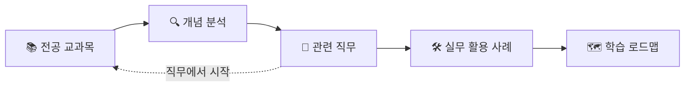

<div align="center">

# 🎓 Class2Career

### 내가 배우는 수업은 어디에 쓰일까?

전공 교과목에서 관련 직무와 실무 활용 사례까지,<br>
진로 탐색을 **한 흐름**으로 연결해 주는 웹 서비스

[**🚀 바로 체험하기**](https://class2-career-five.vercel.app) · HACKATHON 2026 · 팀 **컴작귀**

</div>

---

## 📌 목차

1. [왜 만들었나요?](#-왜-만들었나요)
2. [어떤 서비스인가요?](#-어떤-서비스인가요)
3. [주요 기능](#-주요-기능)
4. [이렇게 사용해 보세요](#-이렇게-사용해-보세요)
5. [차별점](#-차별점)
6. [기술 스택](#-기술-스택)
7. [프로젝트 구조](#-프로젝트-구조)
8. [향후 계획](#-향후-계획)
9. [팀 소개](#-팀-소개)

---

## 💡 왜 만들었나요?

> 전공 수업을 듣다가 *"지금 배우는 게 실제로 어디에 쓰일까?"* 궁금했던 적 있나요?

학생 **59명**에게 물어봤습니다. (자체 설문조사)

| 질문 | 결과 |
| --- | --- |
| 수업이 실제 직무에서 어떻게 쓰일지 궁금했던 적이 있다 | **97%** (자주 80% · 가끔 17%) |
| 수업과 직무를 연결해 주는 사이트가 있다면 써보고 싶다 | **97%** |

학교에서 배우는 **전공 지식**과 현장에서 쓰이는 **직무** 사이에는 끊어진 다리가 있습니다.

- 수업이 어디에 쓰이는지 알기 어렵다
- 내가 배운 지식과 맞는 직무를 찾기 어렵다

**Class2Career**는 이 둘을 이어 주는 지도입니다.

---

## 🧭 어떤 서비스인가요?

학교 전공 교과목을 기반으로 **관련 직무**와 **실무 활용 사례**를 연결해 주는 진로 탐색 서비스입니다.
어느 방향에서 시작하든 배움과 진로가 하나로 이어집니다.



| 시작점 | 질문 | 얻는 것 |
| --- | --- | --- |
| **📚 전공 탐색** | "내가 배우는 이 과목은 어디에 쓰일까?" | 개념 분석 → 실무 활용 사례 → 관련 직무 |
| **💼 직무 탐색** | "이 직무를 위해 어떤 과목을 공부해야 할까?" | 필요한 전공 과목 → 과목 노트 → 학습 로드맵 |

---

## ✨ 주요 기능

### 1. 교과목별 관련 직무 탐색
전공 교과목과 개념을 고르면 연결되는 직무를 찾아 줍니다.

### 2. 직무별 전공 지식 실제 활용 사례
배운 개념이 직무에서 어떻게 쓰이는지 사례 카드로 보여 줍니다. 사례는 AI(Gemini)가 생성하며, 한 번 생성한 결과는 서버에 저장해 재사용합니다.

> ℹ️ 활용 사례는 *가능한 적용 예시*이며, 특정 기업의 검증된 사례가 아닙니다.

### 3. 추가 학습 및 추천 프로젝트 로드맵
관심 직무에 필요한 학습 내용과 프로젝트를 단계별로 안내합니다. 내가 이미 들은 과목은 제외하고, 아직 듣지 않은 과목 중심으로 추천합니다. (로그인 후 **AI 로드맵 생성**, OpenAI 사용)

### 4. 학습 현황 · 대시보드
수강 과목을 `수강 완료 / 수강 중 / 수강 예정`으로 관리하고, 관심 직무와 과목별 학습 노트를 한곳에서 확인합니다.

### 5. 공모전 정보
로드맵과 함께 학교 공지, 개발 행사 피드에서 가져온 공모전을 보여 줍니다.

> 🔑 과목·직무 탐색은 로그인 없이 이용할 수 있습니다. AI 실무 사례 생성, AI 로드맵 생성, 개인 학습 기록 저장은 로그인이 필요합니다.

---

## 🚶 이렇게 사용해 보세요

로그인 없이도 직무 탐색을 체험할 수 있고, 로그인하면 내 수강 과목 기준으로 더 맞춤화됩니다.

### 🔐 로그인한 경우
1. **수강 과목 등록** — 내가 배우는 전공 교과목을 추가
2. **핵심 개념 선택** — 과목 안에서 궁금한 개념 고르기
3. **개념 분석** — 선택한 개념이 어떤 직무와 이어지는지 확인
4. **관련 직무 · 활용 사례** 확인
5. **로드맵** — 관심 직무에 필요한 추가 학습과 프로젝트 확인
6. **학습 · 대시보드** — 진행 상황 확인

### 👤 로그인하지 않은 경우
1. **직무 탐색** 진입
2. **관심 직무** 분석
3. **관련 과목** 보기
4. **로드맵** 확인

> 👉 [**class2-career-five.vercel.app**](https://class2-career-five.vercel.app) — 모바일과 PC 어디서나 접속할 수 있습니다.

### 활용 예시

| 전공 교과목 | 관련 직무 | 실무 활용 사례 |
| --- | --- | --- |
| 데이터베이스 | 데이터 엔지니어 · 백엔드 개발자 | 대용량 서비스의 데이터 설계와 쿼리 최적화 |
| 알고리즘 | 소프트웨어 엔지니어 | 검색·추천 같은 서비스 로직의 성능 개선 |
| 운영체제 | 시스템·인프라 엔지니어 | 서버 자원 관리와 장애 대응 |

*서비스 이해를 돕기 위한 예시입니다.*

---

## 🆚 차별점

| | 일반적인 진로 탐색 | **Class2Career** |
| --- | --- | --- |
| **출발점** | 직무 · 채용공고 | **내가 배운 전공 교과목** |
| **방식** | 직무를 먼저 보고 내 전공과의 연결을 찾음 | 배운 개념에서 직무와 활용 사례를 찾음 |
| **방향** | 단방향 | **양방향** (전공 → 직무, 직무 → 전공) |
| **이후** | 정보 조회로 끝남 | 학습 로드맵과 대시보드로 이어짐 |

---

## 🛠 기술 스택

| 영역 | 사용 기술 |
| --- | --- |
| **Frontend** | React 19 · TypeScript · Vite · CSS |
| **Backend / DB** | Supabase (Auth · PostgreSQL · Row Level Security · Edge Functions) |
| **AI** | Gemini API (개념 활용 사례) · OpenAI API (학습 로드맵) — 모두 Edge Function에서 서버 측 호출 |
| **배포** | Vercel (프론트엔드) · Supabase (백엔드) |
| **협업 · 디자인** | Git · GitHub · Figma |

**설계 포인트**

- 🔒 AI API 키는 브라우저에 노출하지 않고 **Supabase Edge Function**에서만 사용합니다.
- 🛡 사용자별 데이터는 **RLS(Row Level Security)** 로 접근을 제한합니다.
- ♻️ 같은 개념 조합의 AI 분석 결과는 DB에 **캐시**해 재사용합니다.
- 📊 AI 로드맵 생성에는 **사용 횟수 제한(quota)** 을 두어 비용을 관리합니다.

---

## 📁 프로젝트 구조

```
Class2Career
├── frontend/                  # React + Vite 웹 앱
│   ├── src/                   # 페이지 · 컴포넌트 · 훅
│   │   └── roadmap/           # AI 로드맵 · 공모전 UI
│   ├── api/                   # 서버리스 API (개발 행사 피드)
│   └── tests/                 # 단위 테스트
└── supabase/
    ├── migrations/            # DB 스키마 (프로필 · 직무 카탈로그 · 개념 사례 등)
    ├── functions/
    │   ├── generate-concept-examples/   # 개념별 활용 사례 생성 (Gemini)
    │   └── generate-roadmap/            # 직무별 학습 로드맵 생성 (OpenAI)
    └── seed-*.sql             # 과목 · 개념 · 직무 시드 데이터
```

---

## 🌱 향후 계획

- **매 학기 교과목 업데이트 · 직무 데이터 확대** — 더 많은 전공과 직무를 담습니다.
- **활용 사례 고도화** — 현업 사례를 더 풍부하고 정확하게 제공합니다.
- **맞춤 학습 추천** — 외부 사이트 연동 로드맵으로 공모전을 찾아 정리하고, 지금 할 일을 체크리스트로 관리합니다.

일회성 조회가 아닌 **꾸준한 진로 설계 도구**로 키워 가겠습니다.

---

## 👥 팀 소개

**컴작귀** · HACKATHON 2026

| 이름 | 역할 |
| --- | --- |
| 강예은 | 프론트엔드 · 백엔드 |
| 국미승 | 백엔드 |
| 김경민 | 프론트엔드 |
| 박솔 | 백엔드 |
| 하가연 | 디자인 · 프론트엔드 |

---

<div align="center">

**Class2Career** — 수업이 진로가 되는 경험

[🚀 서비스 바로가기](https://class2-career-five.vercel.app) · [📦 GitHub](https://github.com/gukmiseung/Class2Career)

</div>
