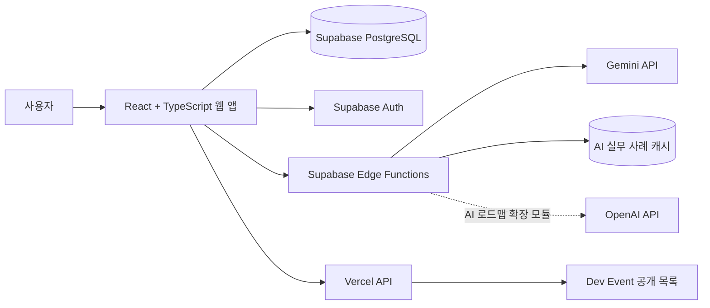

<div align="center">

# 🎓 Class2Career

### 내가 배우는 수업은 어디에 쓰일까?

**전공 교과목 → 핵심 개념 → 실무 활용 사례 → 관련 직무 → 다음 학습**  
학교에서 배운 지식과 실제 개발 직무 사이의 연결고리를 만드는 진로 탐색 웹 서비스

**2026 해커톤 출품작 · 팀 컴작귀**

[🌐 서비스 체험하기](https://class2-career-five.vercel.app/) · [💻 GitHub Repository](https://github.com/gukmiseung/Class2Career)

</div>

---

## 1. 프로젝트 소개

> **“이 수업에서 배우는 내용은 나중에 어디에 쓰이지?”**

대학생은 다양한 전공 수업을 듣지만, 지금 배우는 개념이 어떤 직무에서 어떻게 활용되는지 체감하기 어렵습니다. 반대로 관심 있는 직무가 생겨도 어떤 전공 과목을 우선 학습해야 하는지 파악하기 쉽지 않습니다.

**Class2Career**는 경북대학교 컴퓨터학부 교과목을 출발점으로 **전공 지식과 실무 활용 사례, 관련 직무, 후속 학습 활동**을 연결합니다. 관심 직무에서 출발해 필요한 교과목을 역으로 탐색할 수도 있습니다.

### 문제를 확인한 자체 설문조사

학생 **59명**을 대상으로 조사한 결과:

| 질문 | 결과 |
| --- | --- |
| 전공 수업이 실제 직무에서 어떻게 쓰이는지 궁금했던 적이 있나요? | **57명(97%)**이 ‘자주’ 또는 ‘가끔’ 경험 |
| 수업과 직무를 연결해 보여 주는 사이트가 있다면 사용하고 싶나요? | **57명(97%)**이 ‘그렇다’ 응답 |

*출처: 팀 자체 설문조사, 응답자 59명. 표본 전체 학생을 대표하는 통계는 아닙니다.*

## 2. 핵심 차별점

### 전공 ↔ 직무, 양방향 탐색

| 출발점 | 탐색 과정 | 얻을 수 있는 것 |
| --- | --- | --- |
| 📚 **전공 과목** | 교과목 선택 → 개념 확인 → 실무 활용 사례 → 관련 직무 | **내가 배우는 내용이 어디에 쓰이는지** |
| 💼 **관심 직무** | 직무 검색 → 직무 상세 → 관련 교과목 및 개념 → 로드맵 | **목표 직무를 위해 무엇을 배워야 하는지** |

단순한 직무 소개에 그치지 않고 **배운 지식을 실제 서비스의 기능과 연결**하고, 탐색 이후에는 **프로젝트·공모전·주간 실행 계획**으로 이어지도록 설계했습니다.

## 3. 주요 기능

### ① 교과목 탐색 및 수강 이력 관리
- 경북대학교 컴퓨터학부 교육과정 기반 교과목 검색
- 학과·전공, 이수 구분, 권장 학년 필터 제공
- 과목별 설명, 학점, 과목 코드 등 확인
- 로그인 후 과목 상태를 **수강 완료 / 수강 중 / 수강 예정**으로 등록하고 변경

### ② 전공 개념 분석 및 AI 실무 활용 사례
- 교과목별 핵심 개념과 설명 제공
- 선택한 개념을 실제 소프트웨어 기능에 연결한 **한국어 활용 사례 3개** 생성
- **Gemini API**를 Supabase Edge Function에서 호출해 API 키를 서버에 보관
- 입력 개념의 내용에 기반한 **서버 측 캐시**와 클라이언트의 중복 요청 방지 로직 활용
- 인증 상태, 생성 오류, 재시도를 고려한 화면 처리

> 생성된 사례는 **개념 이해를 돕는 응용 예시**입니다. 특정 기업의 실제 내부 구현을 검증한 사례로 제시하지 않습니다. AI 활용 사례 생성에는 로그인이 필요합니다.

### ③ 직무 탐색 및 교과목 매칭
- 개발, 데이터·AI, 디자인·기획, 인프라, 보안 분야 직무 탐색
- 키워드 검색과 분야별 필터
- 직무별 설명, 연관 교과목, 학습 개념 확인
- 관심 직무 저장 및 관리
- Supabase에 저장된 **교과목–직무 연결 데이터**를 기반으로 관계 표시

### ④ 직무별 학습 로드맵
- **현재 수강 이력 → 다음 전공 학습 → 프로젝트 경험 → 직무 준비** 흐름 시각화
- 직무 연관 교과목 중 이수 상태에 따른 진행 현황 표시
- 직무에 연관된 **공모전·해커톤 추천** 및 공식 공고 링크 제공
- **이번 주 실행 계획**과 체크리스트, 진행률 표시
- 체크리스트 상태는 브라우저 로컬 저장소에 보관

공모전 기능은 큐레이션된 공고와 **Dev Event 공개 목록을 조회하는 서버 API**를 함께 활용합니다. 외부 목록을 가져오지 못하는 경우에는 보유한 공고 데이터를 활용하며, 실제 모집 일정과 참가 조건은 주최 측 공고에서 재확인해야 합니다.

### ⑤ 나의 학습 현황
- 수강 완료·수강 중·수강 예정 과목과 관심 직무를 한 화면에서 확인
- 등록한 학습 상태 수정·삭제
- 교과목 및 관심 직무에 대한 개인 메모 작성
- Supabase Auth 기반 회원가입, 로그인, 이메일 인증, 비밀번호 재설정

> 수강 이력·관심 직무 등 계정 데이터는 Supabase에 저장됩니다. 일부 메모와 주간 체크리스트는 **브라우저 로컬 저장소**를 사용하므로 기기 간 자동 동기화를 보장하지 않습니다.

## 4. 사용 방법 및 시연 시나리오

### 📚 시나리오 A — 전공 과목에서 출발

1. 로그인 후 **전공 과목 탐색**에서 관심 과목을 검색합니다.
2. 수강 상태를 등록하고 과목의 핵심 개념을 선택합니다.
3. 개념 분석 페이지에서 **AI 실무 활용 사례 3개**를 확인합니다.
4. 연결된 직무를 살펴보고 관심 분야를 발견합니다.
5. **나의 학습 현황**에서 등록한 과목과 관심 직무를 확인합니다.

### 💼 시나리오 B — 관심 직무에서 출발

1. 로그인 없이도 **직무 탐색**에서 희망 직무를 검색할 수 있습니다.
2. 직무 상세 페이지에서 연관 교과목과 핵심 학습 내용을 확인합니다.
3. **로드맵**에서 추천 준비 경로와 공모전·해커톤을 확인합니다.
4. **이번 주 실행 계획**의 과제를 체크하며 활동을 구체화합니다.

**🔗 [지금 Class2Career 체험하기](https://class2-career-five.vercel.app/)**

## 5. 기술 스택

| 영역 | 기술 | 활용 |
| --- | --- | --- |
| Frontend | **React 19, TypeScript, JavaScript, HTML, CSS, Vite** | 페이지·컴포넌트 개발, 검색·필터, 반응형 UI |
| Backend | **Supabase Edge Functions (TypeScript / Deno), Vercel Serverless API** | AI 호출, 인증 검증, 외부 공고 조회 |
| Database & Auth | **Supabase PostgreSQL, Supabase Auth, RLS** | 교과목·직무 데이터, 사용자별 기록, 접근 제어 |
| AI | **Google Gemini API** | 선택한 개념의 실무 활용 사례 생성 |
| AI 확장 모듈 | **OpenAI API** | 수강 이력을 고려한 AI 로드맵 생성 기능 개발 |
| Design & Collaboration | **Figma, Git, GitHub, VS Code, Codex CLI** | UI/UX 설계, 버전 관리 및 협업 |
| Deployment | **Vercel, Supabase** | 웹 배포 및 서버리스 함수 운영 |

### 서비스 데이터 흐름



**AI 실무 사례 생성의 핵심 흐름**

1. 사용자가 개념을 선택하면 프론트엔드가 Edge Function에 개념 ID를 전달합니다.
2. 서버에서 **사용자 인증 및 개념 데이터 조회**를 수행합니다.
3. 개념 ID·이름·설명·그룹에 기반한 해시로 `c2c_concept_examples` 캐시를 조회합니다.
4. 캐시가 있으면 재사용하고, 없으면 Gemini에 생성 요청을 보냅니다.
5. 서버에서 결과 형식을 검증한 후 사례 3개를 반환하고 저장합니다.

이 구조는 **동일 개념을 볼 때 불필요한 AI API 재호출을 줄이도록** 설계되었습니다. 생성 실패나 캐시 접근 오류는 별도로 처리합니다.

## 6. 프로젝트 구조

```text
Class2Career/
├── frontend/
│   ├── src/
│   │   ├── App.tsx                   # 페이지 흐름·라우팅
│   │   ├── CourseAddPage.tsx         # 과목 검색·등록
│   │   ├── ConceptSelectionPage.tsx  # 핵심 개념 선택
│   │   ├── ConceptAnalysisPage.tsx   # 개념 분석·실무 사례
│   │   ├── CareerPage.tsx            # 직무 목록·검색
│   │   ├── CareerDetailPage.tsx      # 직무 상세·관련 교과목
│   │   ├── LearningPage.tsx          # 나의 학습 현황
│   │   ├── RoadmapPage.tsx           # 로드맵·공모전·실행 계획
│   │   ├── roadmap/                  # 로드맵 및 공모전 관련 로직
│   │   ├── contexts/                 # 인증·수강 상태 컨텍스트
│   │   └── lib/supabase.ts           # Supabase 클라이언트
│   ├── server/                       # Dev Event 공고 조회 로직
│   ├── api/                          # Vercel API 엔드포인트
│   ├── tests/                        # 주요 로직 테스트
│   └── package.json
├── supabase/
│   ├── functions/
│   │   ├── generate-concept-examples/ # Gemini 실무 사례 생성·캐시
│   │   └── generate-roadmap/         # AI 로드맵 생성 서버 모듈
│   ├── migrations/                   # 데이터베이스 마이그레이션
│   └── seed-*.sql                    # 개념·교과목 관련 시드 데이터
└── .gitignore
```

## 7. 로컬 실행

### 사전 준비
- Node.js 및 npm (저장소의 Vite 버전과 호환되는 버전)
- Supabase 프로젝트 및 접근 가능한 교과목·직무 데이터

### 설치 및 실행

```bash
git clone https://github.com/gukmiseung/Class2Career.git
cd Class2Career/frontend
npm ci
```

`frontend/.env.local`을 생성하고 **본인 Supabase 프로젝트의 공개용 클라이언트 값**을 입력합니다.

```dotenv
VITE_SUPABASE_URL=YOUR_SUPABASE_PROJECT_URL
VITE_SUPABASE_PUBLISHABLE_KEY=YOUR_SUPABASE_PUBLISHABLE_KEY
```

```bash
npm run dev      # 개발 서버
npm run build    # 타입 검사 및 프로덕션 빌드
npm run lint     # Oxlint 검사
npm run preview  # 빌드 결과 미리보기
```

**주의:** 클라이언트 환경변수에는 공개 가능한 Supabase publishable key만 사용합니다. `GEMINI_API_KEY`, `OPENAI_API_KEY`, `SUPABASE_SERVICE_ROLE_KEY` 같은 비밀 키는 **프론트엔드나 GitHub에 넣지 않고 서버 측 Secrets에 설정**해야 합니다.

### Supabase Edge Function 배포(관리자용)

```bash
# 저장소 루트에서 실행
supabase functions deploy generate-concept-examples --project-ref <YOUR_PROJECT_REF>
supabase functions deploy generate-roadmap --project-ref <YOUR_PROJECT_REF>
```

- `generate-concept-examples`: 서버 Secrets에 `GEMINI_API_KEY` 필요 (`GEMINI_MODEL` 선택 사항)
- `generate-roadmap`: 서버 Secrets에 `OPENAI_API_KEY` 필요 (`ROADMAP_AI_MODEL` 등 선택 사항)
- 데이터베이스는 별도 스키마·기본 데이터가 필요합니다. **현재 저장소의 마이그레이션 및 시드 파일만으로 빈 Supabase 프로젝트에 운영 DB 전체가 자동 재구성된다고 보장하지 않습니다.**

## 8. 현재 구현 범위 및 향후 계획

| 구분 | 상태 |
| --- | --- |
| 교과목·직무 양방향 탐색 | ✅ 화면 및 데이터 연결 구현 |
| 핵심 개념 분석 및 Gemini 실무 활용 사례 | ✅ 프론트엔드·Edge Function 및 캐시 로직 구현 |
| 회원 관리·수강 상태·관심 직무·학습 현황 | ✅ 구현 |
| 일반 학습 로드맵·공모전 추천·주간 체크리스트 | ✅ 구현 |
| OpenAI 기반 **AI 개인화 로드맵** | 🧪 Edge Function과 UI 컴포넌트 구현, 현재 `main`의 로드맵 화면에 미연결 |

**향후 발전 방향**
- 매 학기 교육과정 반영 및 연관 직무·교과목 데이터 확대
- 실무 활용 사례의 품질 향상과 근거 자료 보강
- AI 개인화 로드맵의 실제 화면 연동 및 사용성 검증
- 학습·프로젝트 활동 기록의 통합 관리와 지속적인 추천 고도화

## 9. 기대 효과

- **학습 동기 향상:** 수업에서 배우는 개념이 실제 서비스에 어떻게 적용되는지 이해
- **주도적 진로 탐색:** 전공 지식과 관심 직무 사이의 연결 관계를 스스로 비교
- **실행 가능한 학습 계획:** 필요한 교과목 탐색에서 프로젝트·공모전·주간 과제까지 확장

## 10. 팀 소개 — 컴작귀

| 팀원 | 담당 역할 |
| --- | --- |
| 강예은 | 프론트엔드 · 백엔드 |
| 국미승 | 백엔드 |
| 김경민 | 프론트엔드 |
| 박솔 | 백엔드 |
| 하가연 | 디자인 · 프론트엔드 |

---

<div align="center">

### **Class2Career — 수업에서 시작해, 진로로 이어지다.**

[**서비스 바로가기**](https://class2-career-five.vercel.app/) · [**소스코드**](https://github.com/gukmiseung/Class2Career)

</div>